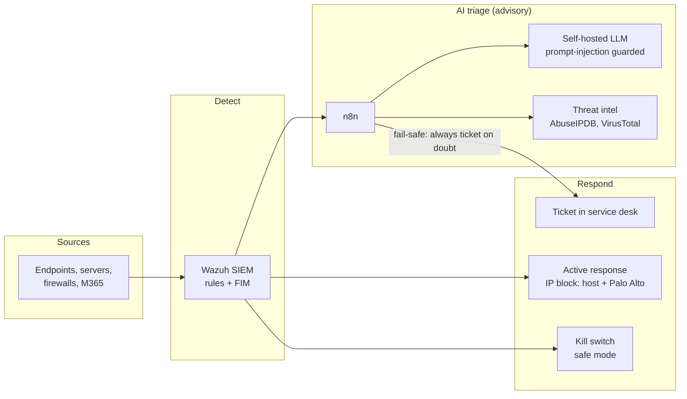

# SOC Alert Triage & RAG Automation (Reference Architecture)

[](https://github.com/smartvels/ai-enabled-security-infra-automation/actions/workflows/security-and-tests.yml)
[](https://scorecard.dev/viewer/?uri=github.com/smartvels/ai-enabled-security-infra-automation)
[](LICENSE)

A reference implementation of an LLM-assisted SOC (Security Operations
Center) automation pipeline, built with self-hosted, open-source
components end to end -- no data leaves the local network.

This is a sanitized version of a platform I designed, built, and piloted as
a proof of concept on 10 endpoints. Hostnames, internal IPs, and credentials
have been replaced with environment-variable placeholders.

## What it does

**Pipeline 1 -- Alert triage and ticketing**
```
SIEM alert (e.g. Wazuh)
   |  webhook
   v
n8n workflow
   |  public source IP? -> threat intel lookup (AbuseIPDB, VirusTotal)
   |  (internal IPs are never sent out; outages fail safe)
   |  builds a classification prompt (alert + reputation, fenced as data)
   v
Self-hosted LLM (e.g. LocalAI + Qwen2.5)
   |  returns { verdict, confidence, reason } (strictly validated)
   v
Fail-safe decision (LLM is advisory only):
   known-malicious source IP, high severity, invalid output, LLM down,
   true_positive, or low-confidence FP   -> ticket in a service desk (e.g. GLPI)
   confident FP on a low-severity alert  -> logged, no action taken
```

**Pipeline 2 -- Retrieval-Augmented Generation (RAG)**
```
Document -> chunked -> embedded (LocalAI) -> stored in pgvector
Question -> embedded -> similarity search in pgvector -> top matches
         -> fed to LLM as context -> grounded answer + cited sources
```

## Platform pillars

This repo covers the **SOC automation and AI/RAG layer** of a larger
reference architecture. For the full picture — dashboard, endpoint
agents, DLP, remote access, correlation engine, and every integrated
tool this pattern is designed to work alongside — see
**[docs/PLATFORM_OVERVIEW.md](docs/PLATFORM_OVERVIEW.md)**.

| Pillar | Implementation | Status in this repo |
|---|---|---|
| **SOC automation** | Wazuh -> LLM triage -> GLPI ticket (`n8n-workflows/`, `triage-service/`) | ✅ Implemented |
| **Incident management** | Ticket creation plus incident tracking with progress and resolution (`it-assistant-portal/`) | ✅ Implemented |
| **Asset management** | Endpoint hardware and software inventory reported by agents (`it-assistant-portal/`) | ✅ Implemented (server side) |
| **Change management** | Change requests with approve / reject / execute workflow (`it-assistant-portal/`) | ✅ Implemented |
| **Endpoint control** | Remote commands queued for agents, remote-desktop links, staged agent rollouts (`it-assistant-portal/`) | ✅ Implemented (server side) |
| **DLP** | DLP event collection, summaries, and scan triggers (`it-assistant-portal/`) | ✅ Implemented (server side) |
| **Automated response** | Wazuh detection rules, kill switch, host and Palo Alto IP blocking (`security/`) | ✅ Implemented, lab-test first |
| **General automation** | n8n | ✅ Orchestration engine for the above |
| **Knowledge / RAG** | pgvector + self-hosted LLM (`n8n-workflows/`) | ✅ Implemented |

**Status meaning:** *Implemented* means the code is in this repo. The
platform was piloted on 10 endpoints as a proof of concept and is not
running in production. *Server side* means the endpoint agent that feeds
the feature is not included in this repo.

## Key design decisions (and why)

- **The LLM is advisory, never authoritative.** Alert content is
  attacker-controlled (usernames, URLs, log text), so it is treated as
  untrusted input: fenced, length-capped, and never allowed to suppress a
  high-severity alert. Any LLM failure creates a ticket instead of
  dropping the alert. Full threat model and OWASP LLM Top 10 mapping in
  **[docs/AI-SECURITY.md](docs/AI-SECURITY.md)**.

- **LLM request bodies are built in code (n8n Code nodes / Python), never
  templated as strings.** Raw LLM text or user input can contain quotes
  and newlines that corrupt a hand-built JSON string. Letting the
  language's own serializer (`JSON.stringify`, `json.dumps`) handle
  escaping avoids an entire class of hard-to-diagnose "invalid JSON"
  errors. See `docs/LESSONS.md` for the specific failure modes this
  avoids.
- **Vector storage (pgvector) runs on its own isolated host**, separate
  from the LLM inference host and the orchestration host, so a
  compromise of one component doesn't automatically expose the others.
- **CI enforces security scanning on every change** (SAST via Bandit,
  secrets scanning via Gitleaks, dependency auditing via pip-audit,
  Dockerfile misconfiguration and container image scanning via Trivy,
  a CycloneDX SBOM for every build, OPA policy checks, and signed,
  provenance-attested images on main)
  before anything merges.

## Defence in depth

| Layer | What is in this repo |
|---|---|
| **Prevent** | Token auth, input fencing, server-side default-deny access control on the portal, hardened non-root read-only container, CI security gates |
| **Detect** | JSON security events and File Integrity Monitoring into Wazuh, custom detection rules |
| **Respond** | Instant kill switch, automatic IP blocking on host and Palo Alto, honeytoken |
| **Supply chain** | Signed images (Cosign), SLSA build provenance, SBOM attestations, OPA policy, tamper tests, deployment gate |
| **Recover** | Rebuild from Git, incident response playbook with CERT-In reporting |

### Architecture



Software supply chain: see **[docs/SUPPLY-CHAIN.md](docs/SUPPLY-CHAIN.md)**.

Start here: **[docs/SECURITY-ROLLOUT-GUIDE.md](docs/SECURITY-ROLLOUT-GUIDE.md)** (step by step)
and **[docs/INCIDENT-RESPONSE.md](docs/INCIDENT-RESPONSE.md)** (playbook).

## Stack

| Layer | Example tool used | Swappable for |
|---|---|---|
| SIEM | Wazuh | Any SIEM with webhook/integration support |
| Orchestration | n8n | Any workflow engine with reliable HTTP handling |
| LLM inference | LocalAI (Qwen2.5-7B) | Any OpenAI-compatible local or hosted LLM |
| Vector store | PostgreSQL + pgvector | Any vector DB |
| Ticketing | GLPI | Any ITSM tool with a REST API |

## Repository layout

```
triage-service/        Standalone Python/Flask reference triage service
n8n-workflows/         Importable n8n workflow JSON (env-var driven, no secrets)
it-assistant-portal/   FastAPI + HTML/JS IT operations portal (AI chat, endpoints, ITSM, DLP, monitoring)
ansible-automation/    Ansible project skeleton with Vault-encrypted secrets pattern
deploy/                Hardened docker-compose runtime (read-only, no capabilities, kill switch)
security/              Wazuh detection rules, FIM config, active-response scripts (Palo Alto block, kill switch)
policy/                OPA/Conftest policies for Dockerfiles and compose files, with unit tests and insecure fixtures
.github/workflows/     CI: secrets, SAST, dependency, container scanning, SBOM, unit tests
docs/                  Design notes, AI security design, lessons learned
```

## Platform context

This repo represents one layer (automation + AI) of a larger reference
architecture unifying SIEM, vulnerability scanning, threat intel,
ticketing, incident response, endpoint control, and remote access. See
`docs/PLATFORM_OVERVIEW.md` for the full picture and how the pieces fit
together.

## Running the triage service standalone

```bash
cd triage-service
python3 -m venv venv
source venv/bin/activate
pip install -r requirements.txt
export LOCALAI_URL=http://localhost:8080/v1/chat/completions
export TRIAGE_API_TOKEN="$(openssl rand -hex 32)"   # callers send this in X-API-Token
gunicorn --bind 127.0.0.1:5050 --workers 2 triage:app
```

## Running the triage service as a container

The service ships with a hardened Dockerfile (slim base image, non-root
user, healthcheck). CI builds the image on every push, scans the
Dockerfile and the image with Trivy, fails on fixable HIGH/CRITICAL
vulnerabilities, and publishes a CycloneDX SBOM as a build artifact.

```bash
docker build -t triage-service triage-service/
docker run -d --name triage -p 127.0.0.1:5050:5050 \
  -e LOCALAI_URL=http://<localai-host>:8080/v1/chat/completions \
  -e TRIAGE_API_TOKEN="$(openssl rand -hex 32)" \
  triage-service
```

Binding the published port to `127.0.0.1` keeps the service off the
network unless you deliberately expose it.

## Importing the n8n workflows

1. Import the JSON files in `n8n-workflows/` via n8n's UI
2. Set these environment variables on your n8n instance:
   ```
   GLPI_URL=<your ticketing API URL>
   GLPI_APP_TOKEN=<your app token>
   GLPI_USER_TOKEN=<your user token>
   N8N_BLOCK_ENV_ACCESS_IN_NODE=false
   ```
3. Create a Postgres credential in n8n pointing at your pgvector instance
4. For threat intelligence, create two **Header Auth** credentials and select
   them in the lookup nodes: `Key: <AbuseIPDB key>` for *AbuseIPDB Lookup*
   and `x-apikey: <VirusTotal key>` for *VirusTotal Lookup*. Keys stay in
   n8n's encrypted credential store, never in the workflow JSON.
5. Replace the `${LOCALAI_HOST}`, `${GLPI_HOST}`, `${PGVECTOR_HOST}`
   placeholders in the workflow JSON with your actual hosts (or convert
   them to n8n environment expressions)

## License

Apache License 2.0 (see [LICENSE](LICENSE) and [NOTICE](NOTICE)). Security issues: see [SECURITY.md](SECURITY.md).
