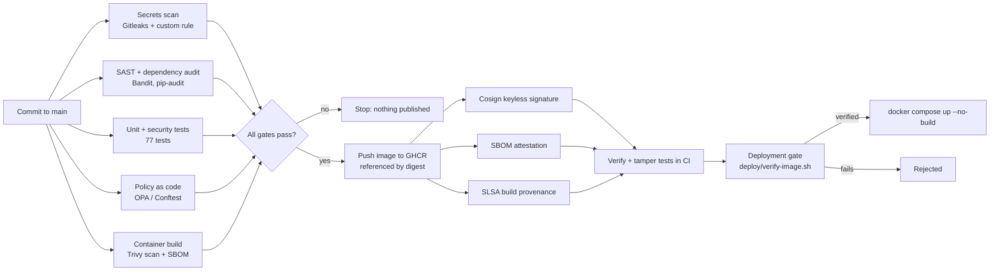

# Software Supply Chain Security

Goal: prove **what** was built, **who** built it, and that it **has not been
tampered with**, and refuse to deploy anything that cannot prove all three.



## Controls

| Control | What it proves or prevents | Where |
|---|---|---|
| **Gated publishing** | Only code on `main` that passed every security gate is ever published | `publish-sign-attest` job (`needs:` all gates) |
| **Digest references** | Tags can be repointed; digests cannot. Only `image@sha256:...` is deployable | CI, `verify-image.sh` |
| **Keyless signing (Sigstore Cosign)** | The image was signed by *this repo's workflow on `main`*, using GitHub's OIDC identity. No long-lived signing key exists to steal | CI |
| **SBOM attestation** | A signed inventory of every package in the image (CycloneDX) is attached to it | CI |
| **Build provenance (SLSA)** | A signed record of the source commit, workflow, and runner that produced the image | `actions/attest-build-provenance` |
| **Policy as code (OPA/Conftest)** | Images must run as non-root, avoid `latest`, use COPY not ADD, define a healthcheck; services must be read-only, drop all capabilities, block privilege escalation, stay off the host network and Docker socket, bind to localhost, and set memory limits | `policy/` |
| **Tamper tests** | CI proves rejection works: insecure Dockerfile and compose files, a wrong signer identity, and a modified unsigned image must all **fail** verification | CI |
| **Deployment gate** | Deployment hosts refuse anything not verified | `deploy/verify-image.sh` |
| **Pinned toolchain** | All GitHub Actions pinned to full commit SHAs; tool images pinned to exact versions | Workflow |
| **Least-privilege CI** | The workflow token is read-only; only the publish job gets package, OIDC, and attestation permissions | Workflow |

## Verify an image yourself

```bash
REF=ghcr.io/smartvels/triage-service@sha256:<digest>
SIGNER=https://github.com/smartvels/ai-enabled-security-infra-automation/.github/workflows/security-and-tests.yml@refs/heads/main

ISSUER=https://token.actions.githubusercontent.com

cosign verify "$REF" --certificate-identity "$SIGNER" --certificate-oidc-issuer "$ISSUER"
cosign verify-attestation "$REF" --type slsaprovenance1 \
  --certificate-identity "$SIGNER" --certificate-oidc-issuer "$ISSUER"
```

Or simply: `deploy/verify-image.sh "$REF"`.

## SLSA level (honest assessment)

GitHub artifact attestations from GitHub-hosted runners provide **SLSA v1.0
Build Level 2** (hosted build, signed provenance). **Level 3** additionally
requires the build to run in an isolated reusable workflow so the calling
workflow cannot tamper with provenance; that is the next step.

## Known limits and next steps

- Base image pinned by tag, not digest (policy issues a warning); next: digest
  pinning with automated updates.
- SLSA Build Level 3 via a reusable build workflow.
- Admission control at runtime (for Kubernetes: Kyverno or Sigstore policy-controller).
- The GHCR package must be set to **public** in its package settings for
  others to pull and verify it.
